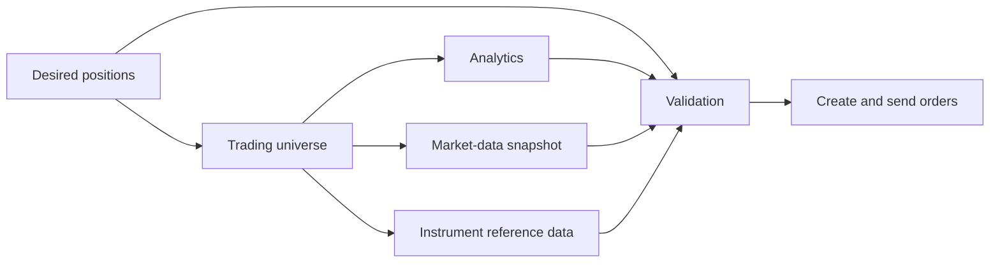

# Introduction

Risk and batch trading computations bring together datasets produced by
independently executing components. A strategy publishes desired positions;
other components determine the instruments required, load supporting data,
validate the proposed positions, and construct orders. These components can
run on different schedules and take different amounts of time. The downstream
computation needs to know which versions of their outputs can be used together.

Consider the following simplified batch trading workflow:

1. A strategy submits its desired positions.
2. The trading universe is updated if necessary.
3. When the universe changes, the system loads analytics, a market-data
   snapshot, and instrument reference data for that universe.
4. The desired positions are validated using those datasets.
5. Following successful validation, orders are created and sent.

The dataflow is shown below. Arrows run from an input to the computation that
consumes it. Analytics and market-data snapshots may also be refreshed on
independent timers; those triggers are omitted from the diagram.

Desired positions reach validation by more than one path. They are a direct
input, and they also determine the universe on which the supporting datasets
depend. For example, instrument reference data depends on the universe, which
in turn depends on desired positions. Validation must reconcile its direct
positions input with the positions accepted along these indirect paths.

Versioning each dataset makes individual publications identifiable, but does
not by itself establish which publications form a coherent view. Suppose a
strategy adds an instrument to its desired positions. The new positions may
arrive at validation before the universe and supporting datasets have been
updated. Taking the latest available value of each dataset could combine
positions for the expanded universe with reference data or analytics loaded
for the preceding universe. Explicit dependency records allow validation to
retain its preceding coherent selection until compatible inputs are available.

A subtler case occurs when the desired positions change without changing the
universe. Suppose `positions@100` requests 100 units of A and 50 units of B.
The universe builder publishes `universe@7`, containing A and B, and records
that it accepted `positions@100`. The analytics, market-data, and reference-data
publications each identify `universe@7` as an input. Validation can combine
these datasets with `positions@100`.

The strategy then publishes `positions@101`, changing the requested quantity
of A to 120 while retaining the same instruments. The universe builder
processes the update and determines that A and B still form the required
universe. No new universe value is needed. Nor does this positions update
require reloading instrument reference data merely to reproduce the same
universe coverage.

The universe's data version alone cannot distinguish two states: the builder
has not yet processed the new desired positions, or it has processed them and
found that the existing universe remains suitable. If no acknowledgement is
recorded, validation cannot establish agreement between `positions@101` and
the older positions dependency reached through the supporting datasets.
Republishing the unchanged universe as a new data version would communicate
progress by introducing a new value identity where none is needed.

hgraph fabric separates a **data version** from a **dependency revision**.
A version identifies an immutable published dataset. A revision records the
input versions accepted by the computation producing or retaining that dataset.
The universe builder can therefore publish `universe@7/r1`, acknowledging
`positions@101` while retaining the data in `universe@7`.

| State | Latest desired positions | Universe record | Positions accepted by the universe | Positions admissible with the existing supporting datasets |
| --- | --- | --- | --- | --- |
| Initial coherent view | `positions@100`: A=100, B=50 | `universe@7/r0`: A, B | `positions@100` | `positions@100` |
| Strategy changes quantities | `positions@101`: A=120, B=50 | `universe@7/r0`: A, B | `positions@100` | `positions@100` |
| Universe builder acknowledges no membership change | `positions@101`: A=120, B=50 | `universe@7/r1`: A, B | `positions@101` | `positions@101` |

Here, `r1` denotes revision 1 within data version 7. Version numbers are local
to each dataset; 101 and 7 are not positions on a shared clock.

The supporting datasets still depend on `universe@7`. Their immediate input
version has not changed, so the acknowledgement does not require new versions
or revisions of those datasets. When validation resolves their transitive
dependencies, it uses the latest known revision of that universe version.
It can consequently establish agreement with `positions@101` and validate the
new quantities using the existing supporting data. The universe's revised
acceptance makes a new combination admissible without changing the universe,
analytics, market-data, or reference-data values.

This acknowledgement is an assertion by the universe builder that its retained
output is suitable for the new desired positions. The supporting datasets
retain their values, while validation runs on the new quantities before
orders are created and sent.
If a later positions update adds instrument C and requires a new universe
version, the supporting publications must establish compatibility with that
new version before the expanded selection is available to validation.

The workflow also separates dependency relationships from execution triggers.
The universe builder responds to desired positions, but need not change its
output on every update. A market-data snapshot or analytics computation can
publish new values on a timer while the universe remains unchanged. Each such
publication records the universe version it accepted. These independently
refreshed datasets need not share a publication time or version number to be
coherent with respect to their declared dependencies. Any additional
relationship, such as analytics consuming a particular market snapshot, must
also be recorded if it is to constrain selection. Application-specific
freshness requirements remain distinct from dependency coherence.

The model extends this reasoning to consumers of multiple datasets with shared,
transitive dependencies. Producers record their immediate accepted input
versions. Consumers resolve those relationships to select a coherent
combination, or *cut*. A dependency-only revision can make a newer cut
admissible even when an intermediate dataset's value remains unchanged.

Coordination is expressed through dataset identities, local version histories,
and dependency acceptance. It does not require comparing timestamps across
producers or assigning all publications to a common clock. The central idea of
hgraph fabric is that independently executing computations publish both data
and acceptance information, allowing consumers to advance coherent views
without requiring every upstream computation to publish a new value.
