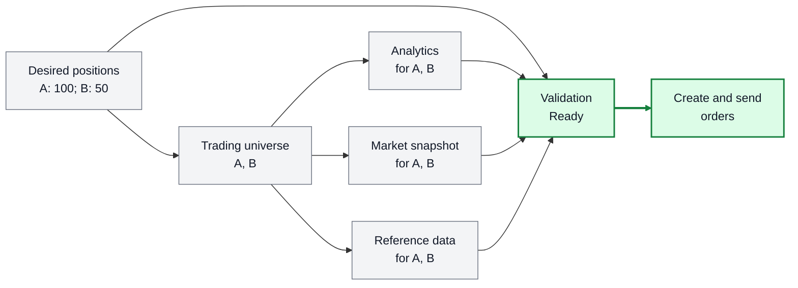
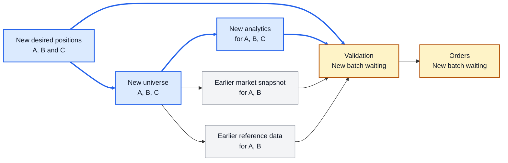
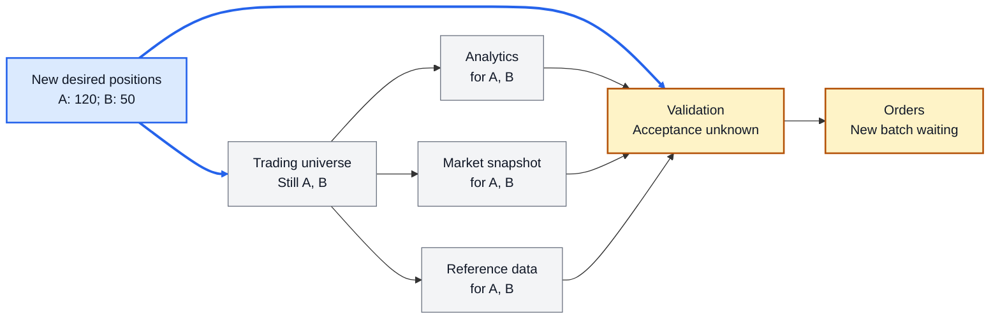
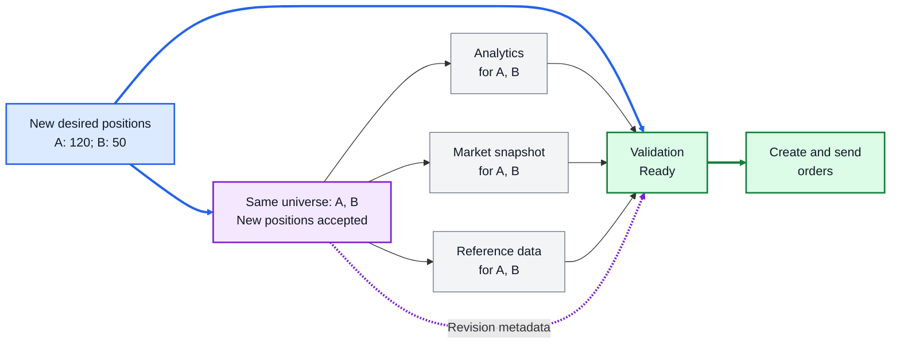
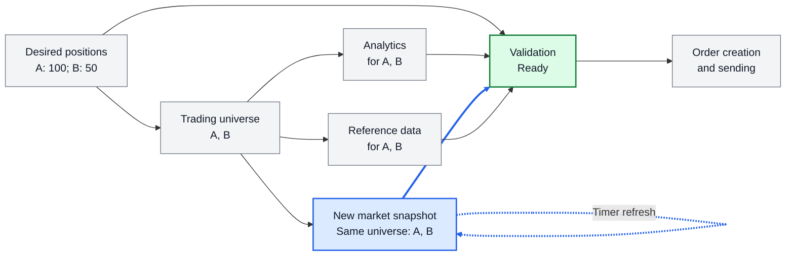

# Introduction

Risk and batch trading computations bring together datasets produced by
independently executing components. A strategy submits desired positions;
other components determine the instruments required, load supporting data,
validate the proposed positions, and construct orders. These components may
run on different schedules and take different amounts of time. The downstream
computation needs to know which publications can be used together.

Consider this simplified workflow:

1. A strategy submits its desired positions.
2. The trading universe is updated if necessary.
3. When the universe changes, the system loads analytics, a market-data
   snapshot, and instrument reference data for that universe.
4. The desired positions are validated using those datasets.
5. Following successful validation, orders are created and sent.

The following pictures repeat this workflow to show different information
flows. Solid arrows run from a dataset to a computation that consumes it.
Blue marks newly published data and its path; purple marks an acknowledgement
without new data; amber marks waiting; and green marks readiness to proceed.
Grey datasets are unchanged or reused. Text labels also identify the relevant
changes, so the distinction does not depend on colour alone. Each scenario
starts from the initial state below unless stated otherwise.

*Figure 1. An initial coherent view: desired positions request 100 units of A
and 50 units of B, and all supporting datasets cover the required universe.*

The positions reach validation directly and indirectly. The indirect paths
pass through the universe and the three supporting datasets. In particular,
reference data depends on the universe, which depends on desired positions.
These paths must agree about which positions have been accepted.

## When the universe changes

Suppose the strategy adds instrument C. Its new positions reach validation
quickly, but updating the universe and loading supporting data takes longer.
The next picture captures an intermediate state: the universe and analytics
include C, while the market snapshot and reference data still cover A and B.

*Figure 2. New positions and analytics have arrived, but the supporting data
is not yet compatible with the expanded universe.*

Taking the latest publication from each input would combine data from different
stages of the update. Validation would receive desired positions that include C,
but market data and reference data that cover only A and B. Each publication may
be valid in isolation, yet their combination is not a valid basis for validating
the new batch.

Validation must ensure that it is processing a consistent set of data before
it can safely compute. This requires establishing that common upstream datasets
have been processed consistently across all contributing input paths. For each
shared upstream dataset, those paths must agree on the published data they have
accepted. Here, the supporting inputs must agree on the universe, and their
indirect positions dependency must agree with validation's direct positions
input. The arrival of new analytics alone provides no evidence that the market
data and reference-data paths have caught up. Waiting for an arbitrary amount
of time provides no such evidence either.

To address this failure, hgraph fabric records which input publications each
computation has accepted. A consumer follows these records across its input
paths and checks agreement at their common upstream datasets. It admits a new
combination only when that agreement is established; otherwise, it retains its
previous coherent selection while the remaining computations catch up.

This motivates giving each published dataset value an identity. A **dataset
ID** names a dataset, such as desired positions or the trading universe. A
**data version** identifies one immutable published value of that dataset.
A **dependency record** identifies the input versions accepted by the producer
of an output. These records let a consumer check agreement along the different
paths rather than infer completion from arrival order or elapsed time.

## When the universe does not change

Return to the initial universe containing A and B. The strategy now changes
only its requested quantity of A, from 100 to 120. The universe builder
processes the positions and finds that the existing universe remains suitable.
No new universe value is needed, so the supporting datasets do not need to be
reloaded merely to reproduce the same instrument coverage.

*Figure 3. New quantities reach validation, but an unchanged universe value
alone does not reveal whether those positions have been processed.*

From downstream, the absence of a new universe publication is ambiguous. The
builder might still be processing the new positions, or it might have finished
and found no change. Data versions distinguish different published values,
but cannot on their own distinguish these two states of computational progress.
Proceeding immediately would assume acceptance that has not been established.
Waiting for a new universe value could instead block the batch indefinitely,
even though the builder has finished and its existing output is suitable.
Validation needs an acknowledgement that the retained universe is suitable
for the new positions. Requiring a new universe data version solely to convey
this fact would give unchanged data a new identity and needlessly change the
input version seen by each supporting-data component.

hgraph fabric represents this acknowledgement with a **revision**. A revision
records the input versions accepted by the computation producing or retaining
a particular data version. A changed dependency record can therefore advance
the revision while leaving the output data version unchanged.

We can now introduce notation for these identities. `dataset_id@version`
denotes a data version: `positions@100` means version 100 of the desired
positions dataset. Appending `/rN` identifies a revision of that version, so
`universe@7/r1` means revision 1 of universe version 7. Revision counts start
at zero within a data version. Version numbers are local to their dataset;
100 and 7 are not positions on a shared clock.

In the initial state, `universe@7/r0` accepts `positions@100`. After the
quantity change, the builder publishes `universe@7/r1`, accepting
`positions@101` while retaining the same universe data. The next picture
shows how that additional information permits progress.

*Figure 4. A new universe revision acknowledges the new positions. Validation
can use the unchanged supporting datasets with the new quantities. The dashed
purple arrow shows dependency metadata consulted during resolution; it is not
an additional direct dataset input to validation.*

The supporting datasets still depend on `universe@7`. Their immediate input
version has not changed, so they need neither new data versions nor new
revisions to reflect this acknowledgement. When validation follows their
recorded dependencies, it resolves the latest known revision of that universe
version and finds acceptance of `positions@101`. The direct and indirect
positions paths can now agree. Validation can process the new quantities,
after which orders can be created and sent.

The universe builder is asserting that its retained output remains suitable
for the new positions. It is not claiming that the supporting computations
ran again. This separation allows consistency to advance through unchanged
intermediate data.

## When a timer refreshes supporting data

Changes do not always originate in desired positions. A market-data snapshot
can refresh on a timer while the positions and universe remain unchanged.
Analytics can likewise be refreshed independently. The next picture shows a
market-data refresh against the initial universe.

*Figure 5. A timer produces a new market snapshot for the same universe. The
other inputs can be reused when their dependency records agree. The dashed
blue arrow is an execution trigger, not a dataset dependency.*

The refreshed snapshot records the universe version it accepted. If that
version agrees with the other inputs, the consumer can admit the snapshot
without waiting for every component to publish again. Conversely, a new
snapshot prepared for a different universe must be reconciled with the other
inputs before it can be selected. The diagram shows availability for
validation; the application's scheduling determines when it constructs and
sends an order batch.

The simplified example has no dependency between analytics and the market
snapshot. If analytics consumes a particular market snapshot, that relationship
must also be recorded and checked. Application-specific freshness requirements
are separate from agreement about dependencies.

Together, these cases motivate **version management** that represents both
published data and computational acceptance. Each producer records its
immediate accepted input versions. Consumers follow those relationships to
select a coherent combination, or **cut**, across their inputs. Data versions
identify values; revisions allow acceptance to advance without inventing new
values. Dependency relationships establish coherence without requiring a
globally coordinated clock or a common publication schedule.
